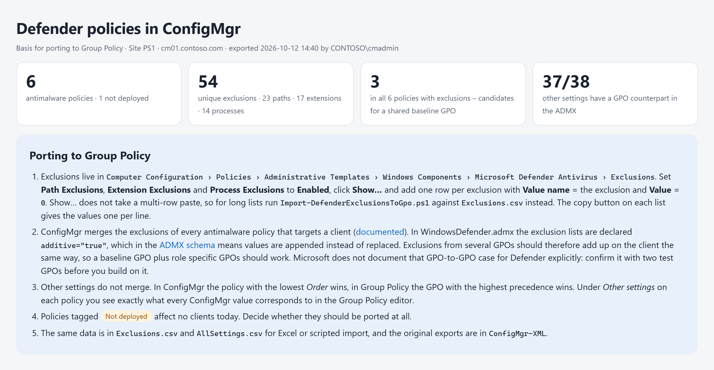
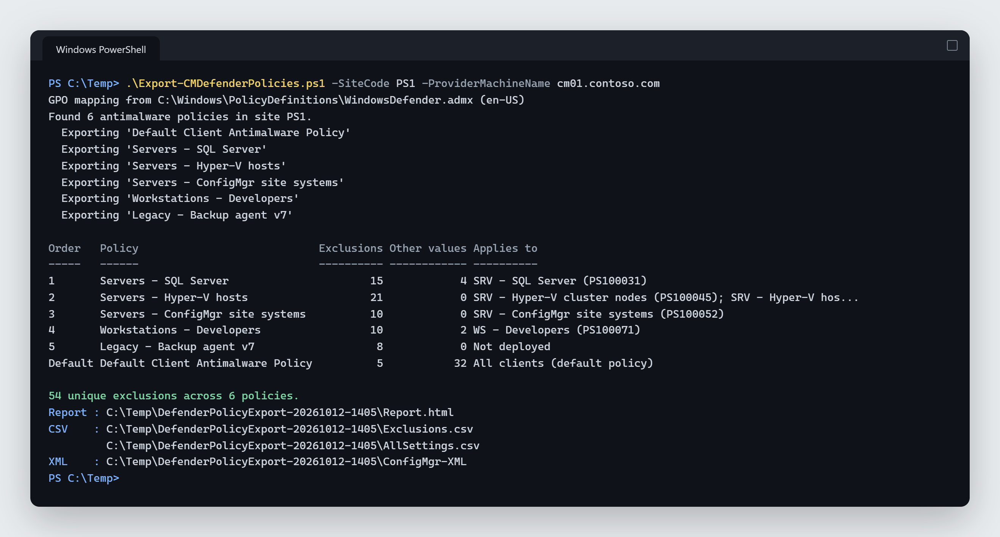
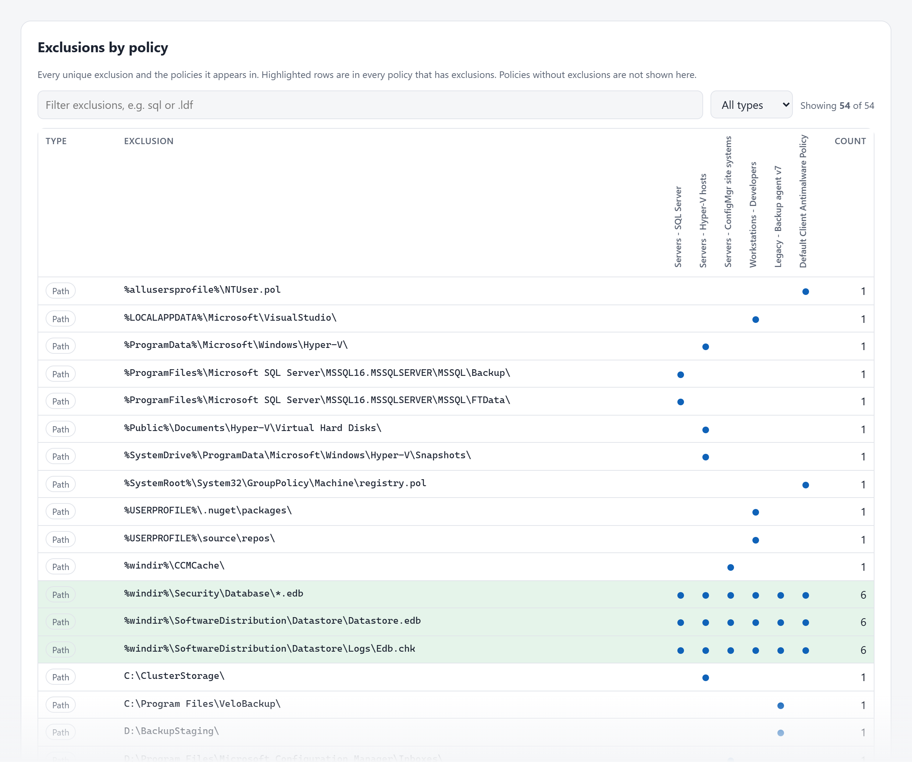
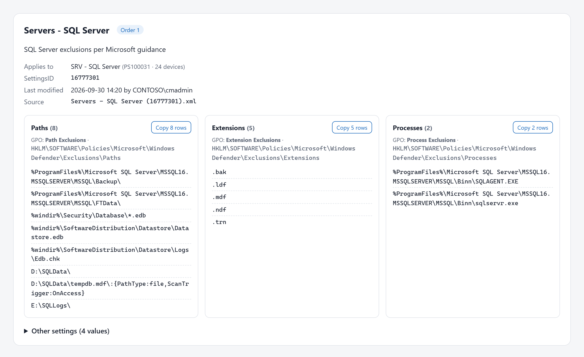
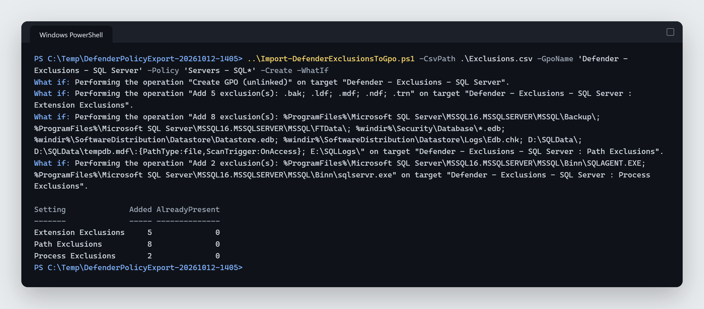
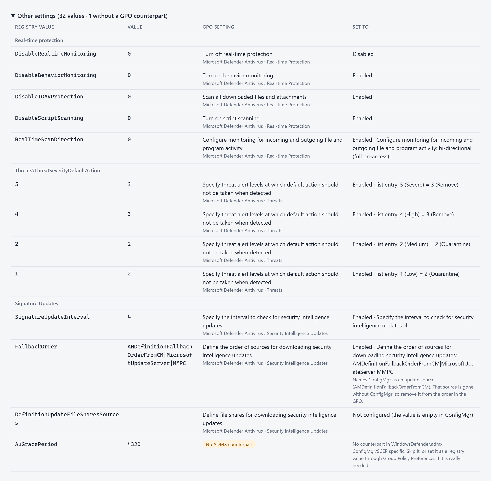

# Export-CMDefenderPolicies

Exports every Microsoft Defender **antimalware policy** from Configuration
Manager and lays the result out for moving it to **Group Policy**. Exclusions
come first, but every other setting is exported too and translated into the
GPO setting it corresponds to.

Moving off ConfigMgr Endpoint Protection means rebuilding those policies
somewhere else, and the exclusion lists are the part nobody wants to retype.
The console shows them one dialog at a time, and `Get-CMAntimalwarePolicy`
does not return them for custom policies. This script exports all of them and
produces a report you can port from, and a second one,
`Import-DefenderExclusionsToGpo.ps1`, writes the exclusion lists into a GPO.

Read-only against ConfigMgr. Nothing in the site is changed.



*All screenshots use fictional data (CONTOSO).*

## Requirements

- Windows PowerShell 5.1 on a machine with the Configuration Manager console
  (the `ConfigurationManager` module). Not needed in offline mode.
- Read access to antimalware policies and collections. *Read-only Analyst* is enough.
- `WindowsDefender.admx` and its `.adml`, from the domain central store or
  `C:\Windows\PolicyDefinitions`, for the GPO mapping.

## Quick start

```powershell
.\Export-CMDefenderPolicies.ps1 -SiteCode PS1 -ProviderMachineName cm01.contoso.com
```

If the session already has exactly one ConfigMgr site drive (for example
PowerShell started from the console), plain `.\Export-CMDefenderPolicies.ps1`
is enough.



| Parameter | Default | |
| --------- | ------- | - |
| `-SiteCode` | the only site drive in the session | Site to export from. |
| `-ProviderMachineName` | – | SMS Provider. Only needed if no drive for `-SiteCode` exists yet. |
| `-Name` | `*` | Only policies matching these patterns. |
| `-XmlPath` | – | Offline mode: build the report from exported XML files or folders. |
| `-OutputPath` | `.\DefenderPolicyExport-<yyyyMMdd-HHmm>` | Output folder. |
| `-AdmxPath` | central store, else `C:\Windows\PolicyDefinitions` | Where `WindowsDefender.admx` is read from. |
| `-Language` | `en` | Report and CSV headers: `en` or `sv`. GPO names stay English, as GPMC shows them. |
| `-CsvDelimiter` | the culture's list separator | `;` or `,` - whatever Excel on that machine expects. |

```powershell
# Only some policies, Swedish report
.\Export-CMDefenderPolicies.ps1 -Name 'Server*', 'SQL*' -Language sv

# Map against the ADMX version your GPMC actually uses
.\Export-CMDefenderPolicies.ps1 -AdmxPath \\contoso.com\SYSVOL\contoso.com\Policies\PolicyDefinitions

# Offline: rebuild the report from earlier exports, no console needed
.\Export-CMDefenderPolicies.ps1 -XmlPath .\DefenderPolicyExport-20261012-1400\ConfigMgr-XML
```

## Output

| File | What it is |
| ---- | ---------- |
| `Report.html` | The deliverable. Policy overview, an exclusion matrix (which exclusion lives in which policy, filterable), and one card per policy with its deployments, its exclusions per GPO setting, and every other setting mapped to GPO. Self-contained, works offline, light and dark, prints with every section expanded. |
| `Exclusions.csv` | One row per policy and exclusion: type, value, how many policies share it, deployments, GPO setting, registry key, value `0`. |
| `AllSettings.csv` | Every registry value every policy sets, ConfigMgr key and GPO key side by side, with the GPO setting, the state to set and any remark. |
| `ConfigMgr-XML\` | Untouched `Export-CMAntimalwarePolicy` output. Re-importable with `Import-CMAntimalwarePolicy`, so it is also your backup before Endpoint Protection is retired. |

The CSV files are UTF-8 with BOM, so Excel detects the encoding.

The exclusion matrix shows which exclusion lives in which policy. Rows found in
every policy are highlighted: candidates for a shared baseline GPO.



Each policy gets a card with its deployments and its exclusions grouped by GPO
setting, each list with its registry key.



> The output contains your environment's exclusion lists - a map of where
> Defender does not look. Treat it accordingly.

## Porting the exclusions

```
Computer Configuration > Policies > Administrative Templates > Windows Components
  > Microsoft Defender Antivirus > Exclusions
      Path Exclusions       HKLM\SOFTWARE\Policies\Microsoft\Windows Defender\Exclusions\Paths
      Extension Exclusions  ...\Exclusions\Extensions
      Process Exclusions    ...\Exclusions\Processes
```

Enable the setting, open **Show…** and add one row per exclusion: **Value
name** = the exclusion, **Value** = `0`. Show… does not take a multi-row
paste, so that is one row at a time. Fine for a handful; for real lists, use
the import script below. The copy button on each list in the report gives the
values one per line, for Notepad, Excel or a single row.

### Importing a whole list into a GPO

`Import-DefenderExclusionsToGpo.ps1` reads `Exclusions.csv` and writes the
exclusions into a GPO with `Set-GPRegistryValue`: the same registry.pol entries
the editor writes (value name = the exclusion, `REG_SZ` `0`), plus the DWORD
that switches each used setting to Enabled (`Exclusions_Paths = 1`, …).

```powershell
# Preview: what would be created and added
.\Import-DefenderExclusionsToGpo.ps1 -CsvPath .\DefenderPolicyExport-20261012-1405\Exclusions.csv `
    -GpoName 'Defender - Exclusions - SQL' -Policy 'Servers - SQL*' -Create -WhatIf

# Do it
.\Import-DefenderExclusionsToGpo.ps1 -CsvPath .\DefenderPolicyExport-20261012-1405\Exclusions.csv `
    -GpoName 'Defender - Exclusions - SQL' -Policy 'Servers - SQL*' -Create
```



- **Additive and idempotent.** Values already in the GPO are left alone and
  nothing is removed. Run it again after a new export and only the new
  exclusions are added. Removing an exclusion is done in the editor.
- **Never links the GPO.** `-Create` creates it unlinked; linking is your step.
- **`-Policy`** picks which ConfigMgr policies' exclusions go in (wildcards),
  so one export can feed a baseline GPO and several role GPOs.
- **Any export language or delimiter.** Columns are read by position.
- Needs the GroupPolicy module (RSAT: Group Policy Management Tools) and the
  right to edit, or create, the GPO.

After the first run, open the GPO in the Group Policy editor and check that
*Path/Extension/Process Exclusions* show as Enabled with the lists in Show….

### Do exclusions from several GPOs add up?

- **ConfigMgr: yes, documented.** The exclusion settings of every antimalware
  policy that targets a device are merged before the client applies them
  ([Endpoint Protection antimalware policies](https://learn.microsoft.com/intune/configmgr/protect/deploy-use/endpoint-antimalware-policies#exclusion-settings),
  *Exclusion settings*).
- **Group Policy: very likely, but inferred.** `WindowsDefender.admx` declares
  the exclusion lists `additive="true"`, which in the ADMX schema means the
  existing values are kept and the list is appended instead of replacing them
  ([additive attribute](https://learn.microsoft.com/previous-versions/windows/it-pro/windows-server-2008-r2-and-2008/cc754311(v=ws.10))).
  Microsoft does not document the GPO-to-GPO case for Defender explicitly.
  Before you design around a baseline GPO plus role specific GPOs, link two
  test GPOs with one path each to a test OU and check that both arrive (see
  *Cutover check*). The report reads the `additive` flag from the ADMX it maps
  against and changes its advice if your version says otherwise.

Other settings do not merge: in ConfigMgr the policy with the lowest *Order*
wins, in Group Policy the GPO with the highest precedence.

## How the GPO mapping works

The settings of a custom policy sit in lazy, embedded `SMS_ClientAgentConfig`
objects on `SMS_AntimalwareSettings`, which is why `Get-CMAntimalwarePolicy`
shows no exclusions for them. `Export-CMAntimalwarePolicy` produces what the
client itself consumes - registry keys and values:

```xml
<AddKey Name="SOFTWARE\Policies\Microsoft\Microsoft Antimalware\Exclusions\Paths">
  <AddValue Name="D:\SQLData\" Type="REG_DWORD">0</AddValue>
</AddKey>
```

The SCEP-era key `...\Microsoft Antimalware\...` is rewritten to
`...\Windows Defender\...` - the value names are the same - and every value is
looked up in `WindowsDefender.admx`/`.adml`:

- **Polarity comes from the ADMX**, it is not guessed. `DisableBehaviorMonitoring = 0`
  becomes *Turn on behavior monitoring = Enabled*, `DisableRealtimeMonitoring = 0`
  becomes *Turn off real-time protection = Disabled*.
- **Drop-downs show the option**, e.g. `ScanParameters = 2` → *Full system scan*.
- **Threat default actions are decoded**: `5 = 3` → *5 (Severe) = 3 (Remove)*.
- **No ADMX counterpart** (e.g. `AuGracePeriod`) is flagged, never dropped.
- **ConfigMgr as an update source** (`AMDefinitionFallbackOrderFromCM` in
  `FallbackOrder`) is flagged: take it out of the order in the GPO.
- **Inactive values** (`Disabled="true"` on a value, key or section) are shown
  as such and kept out of the exclusion lists - the client never applies them.
- **Contextual exclusions** (`path\:{PathType:file,...}`) are tagged in the matrix.



Map against the ADMX store you edit GPOs from: an old central store lacks newer
settings, and the report will then - correctly - show them as having no
counterpart.

## Deployments

Read from `SMS_ClientSettingsAssignment` (`ClientSettingsID` = the policy's
`SettingsID`) with member counts from `SMS_Collection`. A policy that is not the
default and has no deployment is tagged **Not deployed**: it affects no client
today and may not need porting at all.

## Cutover check

On a pilot client after the GPO has applied, as local administrator:

```powershell
gpupdate /force
Get-ItemProperty 'HKLM:\SOFTWARE\Policies\Microsoft\Windows Defender\Exclusions\Paths'
(Get-MpPreference).ExclusionPath
```

Compare with the policy's lists in the report. If *Hide exclusions from local
admins* is enabled, `Get-MpPreference` returns empty lists by design. Move one
collection at a time: link the GPO, remove that collection's antimalware policy
deployment, verify.

## Tests

```powershell
Invoke-Pester -Path .\Tests -Output Detailed
```

Pester 5, no ConfigMgr needed. The suite covers XML parsing, the ADMX mapping
(against the local `WindowsDefender.admx`), site drive selection, and full runs
of the script: offline against the exports in `Tests\Fixtures`, and in site mode
with the ConfigMgr cmdlets stubbed. The import script is tested the same way,
against a real export's `Exclusions.csv` with the GroupPolicy cmdlets stubbed:
what it writes, what it skips, `-WhatIf`, `-Create` and `-Policy`. It passes in
Windows PowerShell 5.1 and PowerShell 7.

Not covered by the tests: how a real domain's Group Policy editor shows what
`Set-GPRegistryValue` wrote. Check that once on a test GPO.

If an export contains elements the script does not interpret, it warns and the
raw XML is kept next to the report. Please open an issue with an anonymised
sample.

## License

[MIT](LICENSE)
